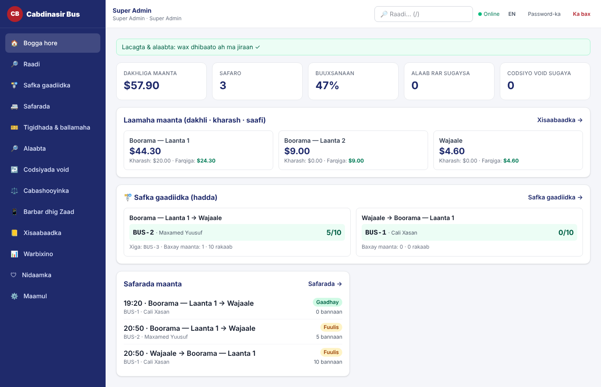
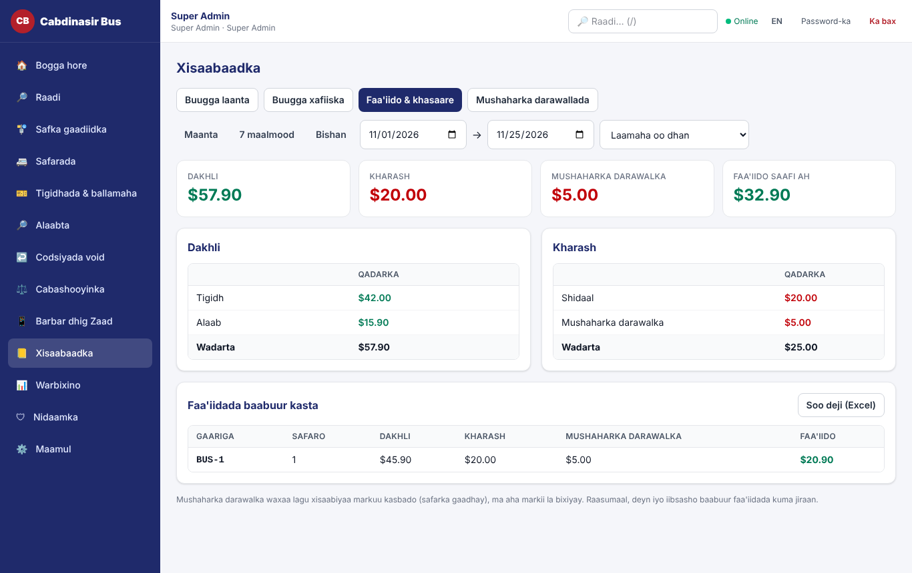
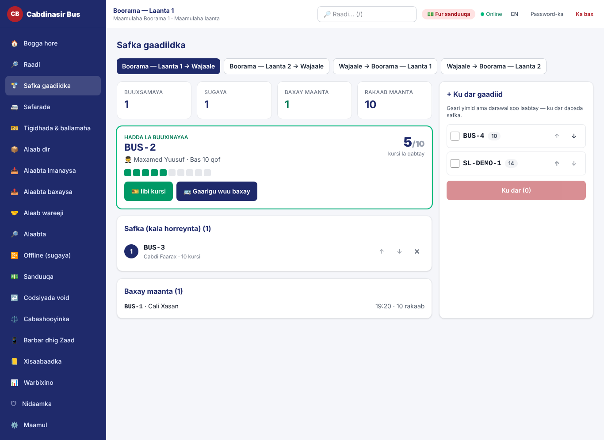
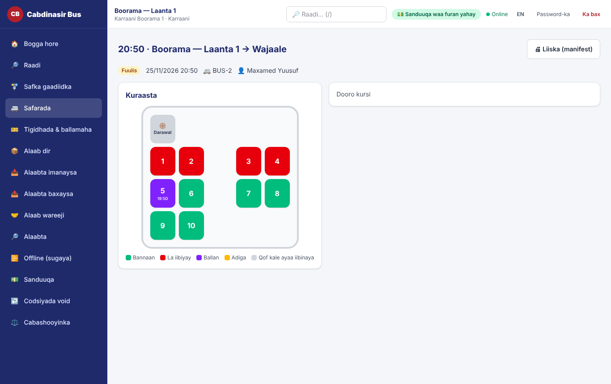
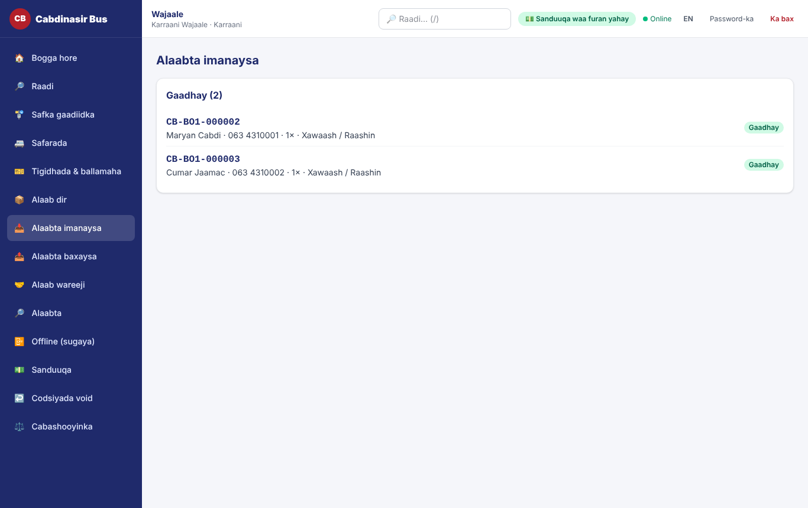
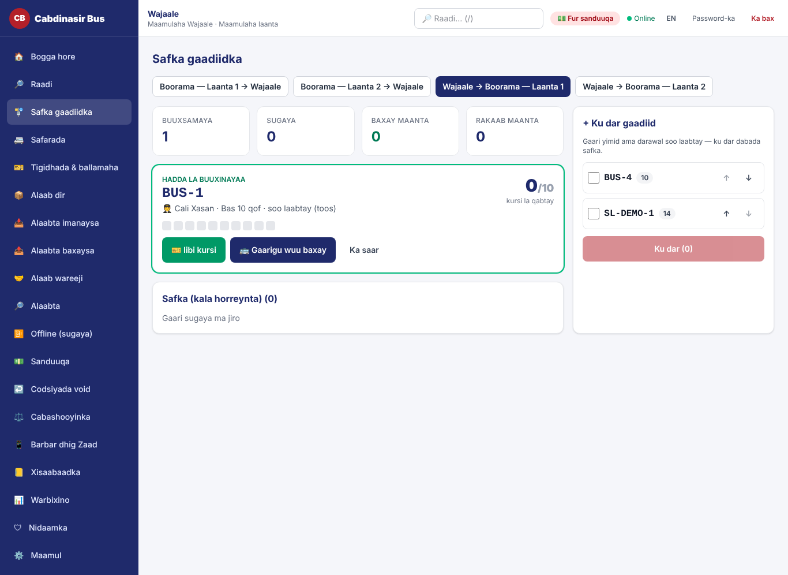

# Bandhigga (Demo) — Cabdinasir Bus

Hagaha bandhigga milkiilayaasha: **sida loo kiciyo**, **sida loo diyaariyo**, iyo **waxa la tusayo** (Super Admin → Boorama 1 → Boorama 2 → Wajaale). Waqtiga: **20–25 daqiiqo**.

---

## A. Kicinta (VS Code) — 5 daqiiqo

1. VS Code → **File → Open Folder** → galka `Cabdi-nisir-Bus` (kan ay ku jiraan `cabdinasir-bus-backend` iyo `cabdinasir-bus-web`).
2. **Run and Debug** (`Ctrl+Shift+D`) → dooro **▶ Kici dhammaan** → **▷** (F5).
3. Sug ilaa labada terminal ay muujiyaan:
   - ⚙️ Backend: `Nest application successfully started`
   - 🌐 Website: `Ready`
   - Kadib laba daaqadood oo Edge ah ayaa furmaya: **👑 Super Admin** iyo **👤 Shaqaalaha**.

> Markii ugu horreysay 3–5 daqiiqo (npm install + database). Kadib ~30 ilbiriqsi.

## B. Diyaarinta — 10 daqiiqo ka hor bandhigga

1. **Xogta bandhigga:** *Terminal → Run Task → 🎬 Xog bandhig* (ama `cd cabdinasir-bus-backend` → `npm run demo:day`).
   Waxay samaynaysaa maalin shaqo oo dhab u eg:
   - safka Boorama 1 → Wajaale: **BUS-1 → BUS-2 → BUS-3**
   - BUS-1: **10/10** tigidh (Boorama 1 + Boorama 2, Cash + Zaad) → BUS-2 si toos ah ayuu iib ugu furmay
   - ballan taleefan · 3 alaab · kharash shidaal $20
   - BUS-1 wuu baxay → Wajaale wuu gaadhay → darawalka $5 (toos) → alaabtii way timid, mid waa la dhiibay (PIN)
   - BUS-1 wuxuu si toos ah u galay safka **Wajaale → Boorama**
2. **Super Admin:** daaqadda 👑 → password `ChangeMe123!` → password cusub samee (tusaale `Bandhig2026!`).
3. Shaashadda weyn (TV / projector) ku xir laptop-ka. Edge: `Ctrl +` si qoraalku u weynaado.

**Haddii aad rabto bilow cusub:** jooji (⏹) → *Run Task → 🧹 Tirtir xogta tijaabada* → mar kale kici → mar kale *🎬 Xog bandhig*.

---

## C. Bandhigga — waxa la tusayo iyo waxa la sheegayo

### 0. Bilow (1 daqiiqo) — dhibaatada hadda
> "Hadda tigidhada iyo alaabta waa warqad: lacag ayaa lumi karta, alaab ayaa lumi karta, xisaabtu waa gacan, milkiiluhuna ma arko waxa laamaha ka dhacaya ilaa habeenkii. Nidaamkan wax walba isla markiiba ayuu muujiyaa."

### 1. 👑 Super Admin — milkiilaha (5 daqiiqo)

| Tus | Sheeg |
|---|---|
| **Bogga hore** | Dakhliga maanta, laamaha (Boorama 1, Boorama 2, Wajaale) — **dakhli · kharash · saafi** laan kasta, isla markiiba |
| **Safka gaadiidka (hadda)** | Gaariga hadda la buuxinayo, kursiyada, kan xiga — meel kasta |
| **"Lacagta & alaabta: wax dhibaato ah ma jiraan ✓"** | Nidaamku maalin kasta wuu hubiyaa — lacag maqan / alaab maqan → digniin (SMS) |
| **📒 Xisaabaadka → Faa'iido & khasaare** | Dakhli − kharash − mushaharka darawalka = **faa'iido saafi** · **faa'iidada baabuur kasta** (gaarigee lacag keena, kee khasaare) · Excel |
| **Mushaharka darawallada** | Darawal kasta: inta uu kasbaday (si toos ah marka safarku gaadho), inta la siiyay, inta lagu leeyahay |
| **Maamul** | Logo · gaadiidka (naqshadeeyaha kuraasta) · qiimaha · laamaha · shaqaalaha · buugga tigidhada warqadda |

### 2. 🏢 Boorama 1 — maamulaha (4 daqiiqo)
Daaqadda 👤 → **Ka bax** → `0631000001` / `Demo1234`

| Tus | Sheeg |
|---|---|
| **🚏 Safka gaadiidka** | Subaxdii maamuluhu wuxuu doortaa gaadiidka shaqeynaya (kuwa maqan ka reeb) → **kala horreyn cadaalad ah** (kii shalay hore u baxay → dabada) |
| BUS-2 **Hadda la buuxinayaa** | Gaariga hore ayaa la buuxiyaa; marka uu buuxsamo kan xiga **si toos ah** ayuu iib u furmaa |
| **🚌 Gaarigu wuu baxay** | Riix → kan xiga ayaa hore u soo dhaqaaqa; **waqtiga dhabta ah** ayaa la qoraa |
| **💵 Sanduuqa** | Karraani kasta sanduuqiisa: lacagta la filayo vs tan gacanta ku jirta → **farqi** → maamulaha ayaa ansixiya |
| **📒 Buugga laanta** | Lacag kasta (tigidh, alaab, kharash, wareejin) **si toos ah** ayay u gashaa — Cash $, SLSH, Zaad, eDahab |

### 3. 🎫 Karraaniga — iib tigidh & alaab (5 daqiiqo)
Daaqadda 👤 → `0631000002` / `Demo1234`

1. **Bogga hore → Tigidh iib** (toos gaariga buuxsamaya) → riix kursi cagaaran (tusaale **6**)
2. Magac + taleefan → **Lambarka tigidhka warqadda** `BO1-1020` → **Bixi $3**
3. Kaarka **"Ku qor tigidhka warqadda"** → *"Karraanigu warqadda buugga ayuu ku qoraa; kombiyuutarka xogta buuxda ayuu hayaa. Lambarka warqadda hal mar oo keliya — tigidh lama khiyaanayn karo."*
4. **Alaab dir** → laanta, nooca, kg → **qiimaha si toos ah** → diiwaangeli → **PIN** (qaataha SMS ayuu helayaa) → **📷 sawir alaabta** (caddayn haddii la yiraahdo "way jabtay")
5. Sheeg: *"Kursi laba jeer lama iibin karo — xataa Boorama 1 iyo 2 isku mar."*

### 4. 🏢 Boorama 2 (2 daqiiqo)
`0633000002` / `Demo1234`
- Isla gaariga (BUS-2) ayay iibinaysaa — **kuraasta waa la wadaagaa**, laakiin lacagta iyo rasiidka waa **Boorama 2** (xisaab gooni ah).
- Kursi 5 = **ballan taleefan** (buluug) → macmiilku marka uu yimaado wuu bixiyaa; haddii uusan iman, si toos ah ayuu u furmaa.

### 5. 🏢 Wajaale (4 daqiiqo)
`0632000002` / `Demo1234`

| Tus | Sheeg |
|---|---|
| **Alaabta imanaysa** | Alaabta BUS-1 way timid — liis |
| **Alaab wareeji** | Raadi taleefanka qaataha → **PIN** (khaldan = diid) → COD lacag → sawirka dhiibista → rasiid |
| **🚏 Safka (Wajaale → Boorama)** | BUS-1 **si toos ah** ayuu u galay safka soo laabashada markuu yimid |

### 6. 📱 Macmiilka (1 daqiiqo) — login la'aan
- http://localhost:3001/track → koodka alaabta + 4-ta god ee taleefanka → **halka ay alaabtu marayso**
- http://localhost:3001/schedule → safarada + kuraasta bannaan

### 7. 🔒 Ammaanka (1 daqiiqo)
- Wax lama tirtiro — **void** + sabab + cidda sameysay (audit)
- Karraanigu void ma samayn karo → **codsi** maamulaha
- Cabashada macmiilka → caddaynta sawirada marxalad kasta → maamulaha ayaa go'aamiya
- Internet go'o → alaabta **offline** ayaa la diiwaangelin karaa → marka uu soo noqdo si toos ah ayay u gudbaan

---

## D. Su'aalaha la filayo

| Su'aal | Jawaab |
|---|---|
| **Internet-ku go'o?** | Alaabta offline way shaqeysaa; tigidhka warqadda (buugga) waa la qori karaa kadibna la geliyaa. Laan kasta: router 4G + SIM shirkad kale (`QALABKA.md`) |
| **Kharashka?** | Server: **$6–12/bishii** · domain **$10–15/sannadkii** · qalabka laantii **$550–950** (`QALABKA.md`) |
| **Tababarka?** | 1 maalin. Karraanigu 4 shaqo ayuu qabtaa: tigidh, alaab, wareejin, sanduuq |
| **Taleefan ma ka shaqeeyaa?** | Haa — website-ka taleefanka/tablet-ka; **"Rakib app-ka"** → icon (app) |
| **Lacagta Zaad?** | Lambarka transaction-ka waa la geliyaa; hal SMS laba jeer lama isticmaali karo; maamuluhu maalin kasta wuu barbar dhigaa |
| **Xogta haddii kombiyuutar xumaado?** | Xogtu server-ka ayay ku jirtaa (ma aha kombiyuutarka) + backup maalinle ah |

---

## E. Akoonnada

| Doorka | Taleefan | Password |
|---|---|---|
| 👑 Super Admin | `0630000000` | `ChangeMe123!` (kadib kan cusub) |
| Maamulaha Boorama 1 | `0631000001` | `Demo1234` |
| Karraani Boorama 1 | `0631000002` | `Demo1234` |
| Maamulaha Boorama 2 | `0633000001` | `Demo1234` |
| Karraani Boorama 2 | `0633000002` | `Demo1234` |
| Maamulaha Wajaale | `0632000001` | `Demo1234` |
| Karraani Wajaale | `0632000002` | `Demo1234` |

**Talo:** bandhigga ka hor hal mar tijaabi (kicin → 🎬 xog bandhig → socodka C). Haddii terminal-ka khalad cas ka muuqdo → sawir u dir Claude.
